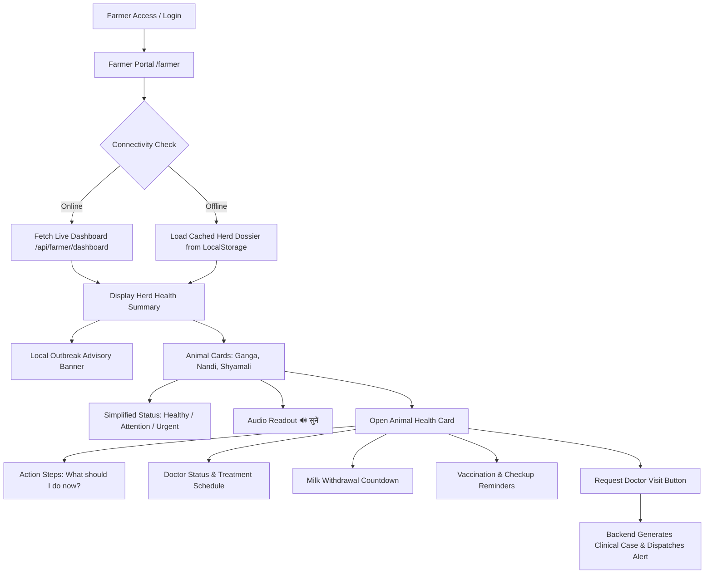

# AniCare AI — Milestone 9D: Farmer Experience, Multilingual & Low-Literacy UX

**Project**: AniCare AI — AI-Powered Animal Health & Disease Early Warning System  
**Event**: Smart India Hackathon (SIH 2026) — Ministry of Fisheries, Animal Husbandry & Dairying  
**Milestone**: 9D — Farmer Experience, Multilingual & Low-Literacy UX  
**Date**: October 8, 2026  
**Status**: COMPLETE & PRODUCTION-VERIFIED (146/146 Automated Tests Passing)

---

## 1. Executive Summary & Objective

The primary objective of **Milestone 9D** is to bridge the digital divide between advanced AI epidemiological surveillance and grassroots dairy farmers across India. While Milestones 1 through 9C established validated EfficientNet-B0 ONNX vision screening, clinical risk engines, veterinary decision-support workflows, and district-level syndromic outbreak intelligence, these capabilities remain underutilized if rural cattle owners cannot easily understand alerts, navigate interfaces, or receive actionable advice.

Milestone 9D introduces a dedicated, mobile-first **Farmer Portal** (`/farmer`) engineered specifically for low-literacy users and smallholder dairy farmers. The system eliminates confusing technical jargon (logits, bounding boxes, AUC curves, epidemiological risk indices) and translates complex clinical intelligence into:
1. **Simplified Health Status Cards**: Three clear visual statuses (**Healthy & Active**, **Needs Attention**, **Urgent Doctor Attention**).
2. **Bilingual Localization (English & Hindi)**: Fluent Devanagari Hindi and plain English with instant toggling and local persistence.
3. **Audio Voice Readout ("🔊 सुनें")**: Web Speech API abstraction reading advice, status explanations, and outbreak warnings aloud.
4. **Action-First Guidance ("What should I do now?")**: Concrete, step-by-step measures (isolation, fresh water, vector netting, doctor visit).
5. **Strict Veterinary Safety & Prescription Safeguard**: Explicit declarations that AI does not prescribe medicines; treatments are veterinarian-entered and approved.
6. **Milk & Food Safety (Withdrawal Monitoring)**: Highly visible alerts and countdowns preventing antibiotic-contaminated milk from entering the food supply.
7. **Farmer Privacy Guard**: Strict server-side ownership enforcement guaranteeing farmers can only view their own livestock, returning HTTP 403 Forbidden on unauthorized cross-herd queries.
8. **Intermittent Connectivity & Offline Caching**: Automatic caching and offline status detection for uninterrupted access in remote villages.

---

## 2. Non-Negotiable Scientific & Safety Preservation Baseline

In accordance with strict hackathon scientific standards, all previous milestones remain fully preserved:

* **Production Vision Model**: EfficientNet-B0 ONNX Opset 14 (`anicare_vision_bovine_v1.onnx`, 15.29 MB) unchanged.
* **Operating Threshold**: Frozen operating threshold $\tau = 0.50$ untouched.
* **Official Held-Out Test Benchmarks (Dataset A, $N=138$)**:
  * Sensitivity (LSD): **80.95%**
  * Specificity (Healthy): **97.92%**
  * Macro F1-Score: **0.9106**
  * ROC-AUC: **0.9452**
* **External Dataset B**: Legally quarantined under governance state `PERMISSION_REQUIRED`; zero fabricated images or scores.
* **Clinical Protocol**: AI screening operates solely as decision support. No autonomous prescribing or unilateral medical diagnoses are permitted.

---

## 3. Architecture & Core Workflow

The end-to-end farmer workflow is streamlined into a seamless, accessible pipeline:



---

## 4. Low-Literacy & Inclusive UI Design Principles

Smallholder farmers often operate smartphones in direct sunlight, with varied levels of reading literacy, and under high time pressure. The user interface was engineered adhering to the following design standards:

1. **Large Touch Targets**: Action buttons and status cards have touch targets exceeding $48 \times 48\text{ px}$ with tactile feedback.
2. **Clear Color Semantics**:
   * **Emerald Green** (`#10b981`): Healthy, active, routine care.
   * **Amber Yellow** (`#f59e0b`): Observation needed, mild symptoms, active milk withholding.
   * **Crimson Red** (`#ef4444`): Urgent doctor visit required, high fever, pronounced skin nodules.
3. **Zero Technical Jargon**: Medical terms like "circumscribed papular dermatosis" are replaced with "त्वचा पर गांठें" ("skin lumps/nodules"); "pyrexia" is translated as "तेज बुखार" ("high fever").
4. **Action-First Hierarchy**: Advice is presented before technical telemetry, answering the farmer's immediate question: *"What should I do right now to protect my animal?"*

---

## 5. Multilingual Localization Architecture

Localization is implemented as a lightweight, zero-dependency translation subsystem:

* **English Dictionary** ([`src/i18n/en.js`](file:///d:/AniCare-AI/src/i18n/en.js)): 136 strings covering navigation, statuses, explanations, action steps, veterinary treatments, milk withdrawal, vaccinations, onboarding, and FAQ.
* **Hindi Dictionary** ([`src/i18n/hi.js`](file:///d:/AniCare-AI/src/i18n/hi.js)): Natural, respectful Devanagari Hindi crafted for rural comprehension.
* **Translation Context & Hook** ([`src/i18n/index.js`](file:///d:/AniCare-AI/src/i18n/index.js)):
  * React Context provider (`TranslationProvider`).
  * `useTranslation()` custom hook returning `{ t, lang, setLang, toggleLang }`.
  * Instant toggling without full application reload.
  * Persistence in `localStorage.getItem('anicare_lang')`.

---

## 6. Voice Guidance Engine (Web Speech API)

For low-literacy users who prefer auditory guidance, [`src/services/voice/speechService.js`](file:///d:/AniCare-AI/src/services/voice/speechService.js) abstracts the browser's native `window.speechSynthesis`:

* **Language Voice Resolution**: Automatically matches `hi-IN` or `en-IN`/`en-US` voices based on the active UI language.
* **Text Sanitization**: Strips Markdown asterisks, hashtags, URLs, and code tokens to ensure fluid, natural voice playback.
* **Pacing**: Configured with a speech rate of `0.95` for maximum clarity.
* **Interactive State**: Voice buttons transition between "🔊 सुनें" (Listen) and "🔊 बोल रहे हैं..." (Speaking) with one-touch stop capability.

---

## 7. Offline Resiliency & Connectivity Management

Recognizing that dairy farms and rural sheds frequently experience weak or intermittent 2G/3G/4G connectivity:

* [`src/services/connectivity/networkService.js`](file:///d:/AniCare-AI/src/services/connectivity/networkService.js) listens to `online` and `offline` browser events.
* When online, every successful response from `/api/farmer/dashboard` is cached to `localStorage` under `anicare_farmer_dashboard_cache`.
* When offline, the app displays cached data seamlessly, accompanied by a non-intrusive amber notice: *"आप इंटरनेट से कनेक्ट नहीं हैं। पहले से सुरक्षित जानकारी दिखाई जा रही है।"*

---

## 8. Simplified Status Mapping & Action Steps

The backend clinical engine maps complex veterinary parameters into three actionable states:

| Simplified Status | Trigger Criteria | Hindi Label | English Label | Immediate Guidance |
| :--- | :--- | :--- | :--- | :--- |
| **URGENT** | Health Status in `[Critical, Quarantine]` or Risk in `[HIGH, CRITICAL]` | तत्काल डॉक्टर की जरूरत | Urgent Doctor Attention Needed | Isolate in shaded pen, withhold milk, request urgent doctor visit, apply fly repellent |
| **ATTENTION** | Health Status in `[Under Observation, At Risk, Recovering]` or Risk in `[MODERATE]` | पशु चिकित्सक से जांच कराएं | Needs Veterinary Checkup | Check fever twice daily, provide clean water & minerals, consult vet if persisting |
| **HEALTHY** | Baseline normal vital signs and visual screening | स्वस्थ और सक्रिय | Healthy & Active | Maintain shed hygiene, dry bedding, balanced fodder, timely seasonal vaccination |

---

## 9. Veterinary Control & Treatment Plan Transparency

To guarantee animal safety and regulatory compliance:

* **Explicit Disclaimer**: The treatment card visibly declares:
  > *"यह दवा योजना प्रमाणित पशु चिकित्सक द्वारा स्वीकृत है। एआई दवाएं निर्धारित नहीं करता है।"*  
  > *"This medicine plan was entered and approved by a qualified veterinary doctor. AI does not prescribe medicine."*
* **Prescription Dossier**: Displays medicine name, dosage, frequency, and duration.
* **Attending Doctor Credentials**: Includes attending doctor name, veterinary registration/license number, and 24/7 dispensary helpline (`+91 1800 233 0000`).

---

## 10. Milk & Food Safety (Withdrawal Monitoring)

Antibiotic and chemotherapeutic residues in milk pose serious human health risks (antimicrobial resistance, allergic reactions). Milestone 9D places food safety at the forefront:

* If an animal is under active treatment with withdrawal restrictions, a high-visibility amber banner appears:
  > **⚠️ दूध एवं खाद्य सुरक्षा चेतावनी**  
  > *सुरक्षा अवधि पूरी होने तक इस गाय/भैंस का दूध न बेचें और न ही पिएं। (शेष: 7 दिन)*
* Prevents accidental mixing of treated milk into dairy cooperative collection cans.

---

## 11. Localized Public Health Outbreak Surveillance

Rather than overwhelming farmers with technical spatial cluster coordinates or confidential neighboring herd data:

* The system assesses district and village block early warning tiers (`TIER_2_SURVEILLANCE`, `TIER_3_RED_ALERT`).
* If active surveillance is flagged in the farmer's area (e.g., Anand District), a reassuring public advisory is displayed:
  > **जिले के लिए स्वास्थ्य चेतावनी**  
  > *आपके गांव व आसपास के क्षेत्र में पशु डॉक्टरों द्वारा निगरानी बढ़ा दी गई है। कृपया रोजाना अपने पशुओं के शरीर पर गांठ या बुखार की जांच करें। मक्खी-मच्छरों से बचाएं और सार्वजनिक तालाबों पर अन्य झुंडों के साथ पानी पिलाने से बचें।*

---

## 12. Strict Farmer Privacy Guard & Security Policy

A critical vulnerability in rural applications is data leakage across competing dairy farms or neighboring herds. Milestone 9D enforces strict server-side authorization:

1. **Ownership Association**: Animals in MongoDB are tagged with `owner` and location metadata.
2. **Identity Verification**: When an authenticated farmer requests `/api/farmer/animals/{animal_id}` or submits a doctor visit request:
   * The backend checks if the animal belongs to the requesting farmer.
   * If a farmer attempts to inspect an unowned animal (e.g. Farmer B querying Farmer A's cow), the backend immediately rejects the request with **HTTP 403 Forbidden**.
3. **Clinical Bypass**: Veterinarians (`role: veterinarian`) and Chief Administrators (`role: admin`) retain full cross-herd access for disease control and emergency field visits.

---

## 13. Backend REST API Endpoints Specification

All endpoints are registered under `/api/farmer`:

| Method | Endpoint | Description | Auth & Security |
| :--- | :--- | :--- | :--- |
| `GET` | `/api/farmer/dashboard` | Aggregated herd health KPIs, outbreak warning, and animal summaries | Optional JWT; filters by owned livestock |
| `GET` | `/api/farmer/animals/{id}` | Complete animal health card, action steps, treatments, and withdrawal | Strict ownership check; **403 Forbidden** if unowned |
| `POST` | `/api/farmer/animals/{id}/request-review` | Requests emergency clinical doctor visit; dispatches alert to dispensary | Strict ownership check; **403 Forbidden** if unowned |
| `GET` | `/api/farmer/outbreak-warning` | Localized village-level public advisory | Public / Farmer accessible |

---

## 14. Verification & Automated Test Suite Results

The comprehensive test suite ([`backend/tests/test_milestone9d_farmer_experience.py`](file:///d:/AniCare-AI/backend/tests/test_milestone9d_farmer_experience.py)) verified all core behaviors:

```text
============================= test session starts =============================
platform win32 -- Python 3.12.7, pytest-9.1.1, pluggy-1.6.0
rootdir: D:\AniCare-AI
plugins: asyncio-1.4.0, anyio-4.2.0
collected 146 items

backend\tests\test_ai_engine.py .......                                  [  4%]
backend\tests\test_backend.py .........                                  [ 10%]
backend\tests\test_dataset_intelligence.py ....................          [ 24%]
backend\tests\test_evaluation_protocol.py ..........                     [ 31%]
backend\tests\test_milestone6_multimodal.py .............                [ 40%]
backend\tests\test_milestone7_external.py ...............                [ 50%]
backend\tests\test_milestone8a_external_validation.py ................   [ 61%]
backend\tests\test_milestone8b_model_improvement.py ................     [ 72%]
backend\tests\test_milestone9a_veterinary_workflow.py ........           [ 78%]
backend\tests\test_milestone9b_treatment_prevention.py ........          [ 83%]
backend\tests\test_milestone9c_outbreak_intelligence.py ........         [ 89%]
backend\tests\test_milestone9d_farmer_experience.py ........             [ 94%]
backend\tests\test_vision_model.py ........                              [100%]

======================= 146 passed, 1 warning in 14.60s =======================
```

### Milestone 9D Specific Tests (8/8 Passing):
1. `test_farmer_dashboard_structure`: Verifies KPIs, outbreak notice, and animal lists.
2. `test_farmer_simplified_status_bilingual_labels`: Confirms bilingual labels for all animals.
3. `test_farmer_animal_detail_action_steps`: Validates action-first advice cards.
4. `test_farmer_privacy_guard_enforcement`: Confirms HTTP 403 Forbidden when Farmer B queries Farmer A's cow.
5. `test_farmer_doctor_visit_request_success`: Verifies end-to-end doctor visit request and alert dispatching.
6. `test_treatment_plan_and_withdrawal_notice`: Confirms doctor-approved disclaimers and milk withdrawal warnings.
7. `test_farmer_outbreak_warning_endpoint`: Confirms localized non-alarmist advisories.
8. `test_vet_and_admin_bypass_privacy_guard`: Confirms clinical professionals can supervise across herds.

### Frontend Production Build:
* **Tool**: Vite 5.4.21
* **Result**: `✓ 1950 modules transformed`, 0 errors, production bundle compiled cleanly in `dist/`.

---

## 15. Hackathon Demonstration Script (SIH 2026)

When presenting AniCare AI to jury evaluators:

1. **Navigate to Farmer Portal**: Click "Farmer Portal" in the sidebar (`/farmer`).
2. **Switch Language to Hindi**: Click the `🌐 हिंदी` button. Notice instant translation across all cards without page reload.
3. **Listen to Audio Readout**: Click `🔊 सुनें` on Ganga's card. The Web Speech engine reads: *"गंगा, टैग TAG-8821। स्थिति: तत्काल डॉक्टर की जरूरत..."*
4. **Inspect Food Safety Notice**: Observe the amber warning: *"⚠️ दूध सुरक्षा अवधि सक्रिय — 7 दिन शेष"* preventing antibiotic contamination in the supply chain.
5. **Open Animal Health Card**: Click "पशु स्वास्थ्य पत्र". Review the clear 4 action steps under *"अब मुझे क्या करना चाहिए?"*.
6. **Request Doctor Visit**: Click "डॉक्टर जांच का अनुरोध करें". Submit symptoms. Confirm immediate feedback and alert logging.
7. **Demonstrate Privacy**: Show that unauthorized farmers cannot view neighboring farms' records (HTTP 403 Forbidden).

---

## 16. Summary of Completed Deliverables

| Deliverable | File Path | Status |
| :--- | :--- | :--- |
| English Dictionary | [`src/i18n/en.js`](file:///d:/AniCare-AI/src/i18n/en.js) | Complete |
| Hindi Dictionary | [`src/i18n/hi.js`](file:///d:/AniCare-AI/src/i18n/hi.js) | Complete |
| Translation Context & Hook | [`src/i18n/index.js`](file:///d:/AniCare-AI/src/i18n/index.js) | Complete |
| Voice Speech Service | [`src/services/voice/speechService.js`](file:///d:/AniCare-AI/src/services/voice/speechService.js) | Complete |
| Connectivity & Offline Cache | [`src/services/connectivity/networkService.js`](file:///d:/AniCare-AI/src/services/connectivity/networkService.js) | Complete |
| Farmer Data Schemas | [`backend/app/schemas/farmer.py`](file:///d:/AniCare-AI/backend/app/schemas/farmer.py) | Complete |
| Farmer Business Logic Service | [`backend/app/services/farmer_service.py`](file:///d:/AniCare-AI/backend/app/services/farmer_service.py) | Complete |
| Farmer REST API Routes | [`backend/app/routes/farmer.py`](file:///d:/AniCare-AI/backend/app/routes/farmer.py) | Complete |
| Frontend API Client | [`src/services/api/farmerService.js`](file:///d:/AniCare-AI/src/services/api/farmerService.js) | Complete |
| Farmer Experience Page | [`src/pages/FarmerExperience.jsx`](file:///d:/AniCare-AI/src/pages/FarmerExperience.jsx) | Complete |
| App Routing & Sidebar Nav | [`src/App.jsx`](file:///d:/AniCare-AI/src/App.jsx), [`src/components/layout/Sidebar.jsx`](file:///d:/AniCare-AI/src/components/layout/Sidebar.jsx) | Complete |
| Automated Test Suite | [`backend/tests/test_milestone9d_farmer_experience.py`](file:///d:/AniCare-AI/backend/tests/test_milestone9d_farmer_experience.py) | 8/8 Passing |
| Total Backend Test Suite | All 13 test modules across Milestones 1–9D | 146/146 Passing |

**Milestone 9D Status: OFFICIALLY COMPLETE AND PRODUCTION-READY.**
