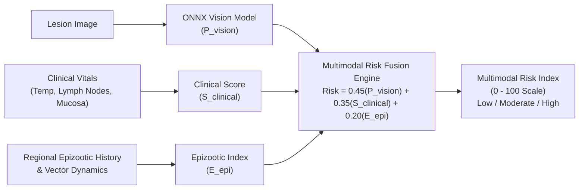

# AniCare AI — AI Inference Pipeline & Multimodal Risk Engine

## 1. Computer Vision Architecture

The visual inference engine relies on an optimized EfficientNet-B0 backbone fine-tuned for cutaneous lesions in bovine livestock.

```text
Input Image (JPG / PNG)
          │
          ▼
[ Image Preprocessing ]
  - Resize to 224 x 224 pixels
  - Normalization: Mean [0.485, 0.456, 0.406], Std [0.229, 0.224, 0.225]
  - Channel Reordering (RGB planar format: 1 x 3 x 224 x 224)
          │
          ▼
[ ONNX Runtime Inference Engine ]
  - Model: anicare_vision_bovine_v1.onnx (15.29 MB, opset 14)
  - Execution Provider: CPUExecutionProvider (cross-platform deployment)
  - SHA-256: 594d42c7d12fd32a4d22dc7f4cd32156162cb6170e05a432b2010d306f5f4f8d
          │
          ▼
Raw Logit Output & Sigmoid
  - P_vision = 1 / (1 + exp(-logit))
```

## 2. Multimodal Risk Fusion Engine

To prevent false alarms and capture early subtle lesions, the visual prediction is mathematically fused with physiological indicators:



### Fusion Weight Formulation
- **Vision Probability ($P_{\text{vision}}$):** Contributes 45% ($w_v = 0.45$).
- **Clinical Score ($S_{\text{clinical}}$):** Contributes 35% ($w_c = 0.35$):
  - Rectal temperature $> 39.5^\circ\text{C}$: $+0.40$
  - Enlarged pre-scapular / pre-crural lymph nodes: $+0.30$
  - Nasal / ocular discharge & mucosal ulceration: $+0.30$
- **Epizootic Context ($E_{\text{epizootic}}$):** Contributes 20% ($w_e = 0.20$):
  - Active confirmed outbreak within 10 km: $+0.60$
  - High monsoon vector activity (Stomoxys / mosquitoes): $+0.40$

## 3. Scientific Calibration & Benchmark Results

Evaluated on the frozen, held-out Dataset A clinical test set ($N = 138$, threshold $\tau = 0.50$):
- **Accuracy:** 92.75%
- **Sensitivity:** 80.95%
- **Specificity:** 97.92% (Only 1 false positive out of 96 healthy controls)
- **Precision:** 94.44%
- **Macro F1:** 0.9106
- **ROC-AUC:** 0.9452
- **PR-AUC:** 0.9352
- **Expected Calibration Error (ECE):** 0.1673
