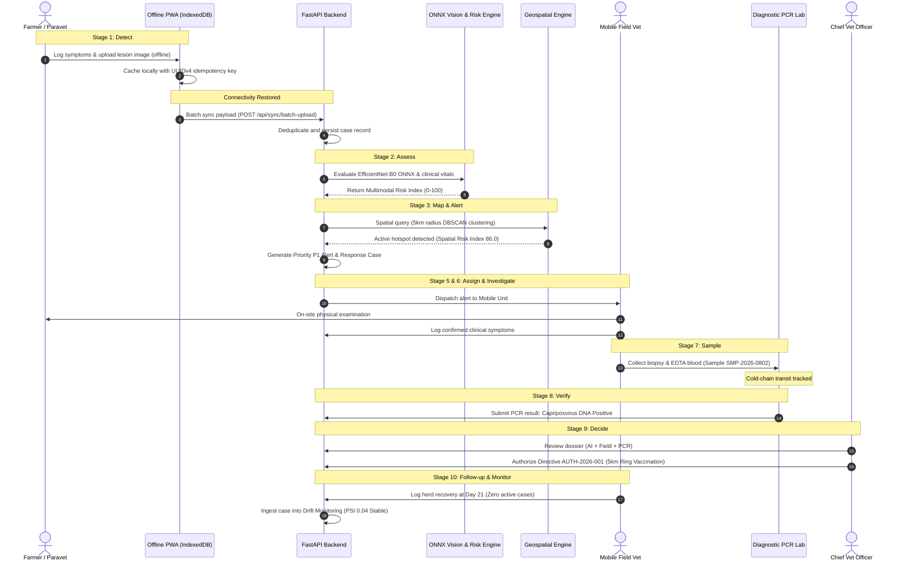

# AniCare AI — End-to-End Data Flow Specification

## 1. Lifecycle Data Flow

The platform guides information through an audited 10-stage lifecycle, ensuring complete traceability from initial village symptom detection to post-intervention surveillance.

## 2. Key Data Entities & Schemas

- **Animal Profile:** Identifies individual animals by Tag ID, species, breed, age, and owner contact.
- **Health Assessment:** Captures clinical signs, body temperature, mucosal condition, visual photo paths, and multimodal risk score.
- **Geospatial Hotspot:** Defines geographic cluster boundaries, center coordinates, radius, infected animal count, and Spatial Risk Index.
- **Response Alert:** Represents prioritized operational notifications (P1/P2/P3) linked to specific response cases.
- **Biological Sample:** Tracks chain of custody from specimen extraction to PCR laboratory validation.
- **Containment Authorization:** Documents regulatory decisions digitally signed by authorized veterinary officers.
