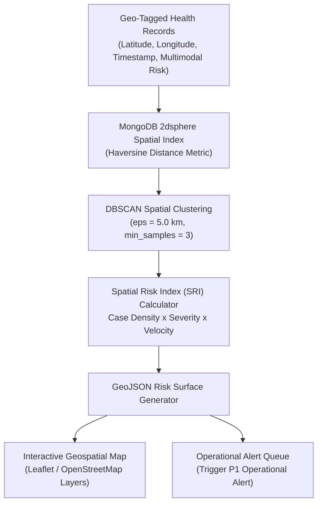

# AniCare AI — Geospatial Disease Intelligence & Risk Mapping

## 1. Geospatial Processing Architecture

The geospatial engine bridges individual animal health records with macro-level epidemiology, transforming isolated reports into village, block, and district early warning signals.

## 2. Mathematical Clustering Formulation

1. **DBSCAN Distance Threshold ($\varepsilon$):** Set to $5.0\text{ km}$, representing the typical grazing radius of rural cattle and active biting-fly vector dispersal distance (e.g., *Stomoxys calcitrans*).
2. **Minimum Cluster Size ($\text{min\_samples}$):** Minimum of $3$ suspected cases reported within a sliding 14-day temporal window.
3. **Spatial Risk Index (SRI):**
   $$\text{SRI} = \min\left(100, \; \bar{R}_{\text{cluster}} \times \ln(N + 1) \times \left(1 + \frac{\Delta \text{Cases}}{\Delta t}\right)\right)$$
   Where:
   - $\bar{R}_{\text{cluster}}$ is the average multimodal risk of animals in the cluster ($0 \le \bar{R} \le 1.0$).
   - $N$ is the number of active cases in the spatial boundary.
   - $\frac{\Delta \text{Cases}}{\Delta t}$ represents infection velocity over the preceding 7 days.

## 3. Threat Level Categorization
- **Critical (Hotspot):** $\text{SRI} \ge 75$ &rarr; Immediate P1 Operational Alert dispatched.
- **High (Warning):** $50 \le \text{SRI} < 75$ &rarr; P2 District Alert with active surveillance mandate.
- **Moderate (Elevated):** $25 \le \text{SRI} < 50$ &rarr; P3 Advisory notice for local field veterinarians.
- **Low (Normal):** $\text{SRI} < 25$ &rarr; Routine baseline monitoring.
