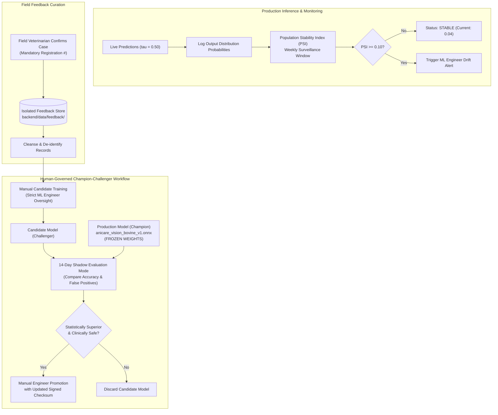

# AniCare AI — AI Model Governance, Drift Surveillance & Scientific Ethics

## 1. AI Lifecycle Governance

AniCare AI implements strict guardrails to protect against model degradation, data leakage, and unauthorized model retraining in clinical livestock environments.

## 2. Core Governance Invariants

### Invariant 1: Frozen Production Model Weights
- File: `backend/ai/models/weights/anicare_vision_bovine_v1.onnx` (15.29 MB)
- Checksum: `594d42c7d12fd32a4d22dc7f4cd32156162cb6170e05a432b2010d306f5f4f8d`
- Threshold: $\tau = 0.50$
- Automated Verification: Continuously checked via test suite `test_6_production_model_sha256_integrity`.

### Invariant 2: Dataset B Strict Quarantine
- Storage Path: `data/external/dataset_b/`
- Policy: Unvetted third-party imagery is strictly quarantined under `PERMISSION_REQUIRED`. It is barred from all automated training, evaluation, and inference pipelines to prevent train-test contamination and respect IP compliance.
- Automated Verification: Enforced by test suite `test_8_dataset_b_quarantine_invariant`.

### Invariant 3: Zero Autonomous Clinical Prescriptions
- The platform enforces an absolute barrier between AI risk scoring and pharmaceutical administration. Drug dosages, antibiotic schedules, and ring vaccination require verified credentials under the Indian Veterinary Council Act.
