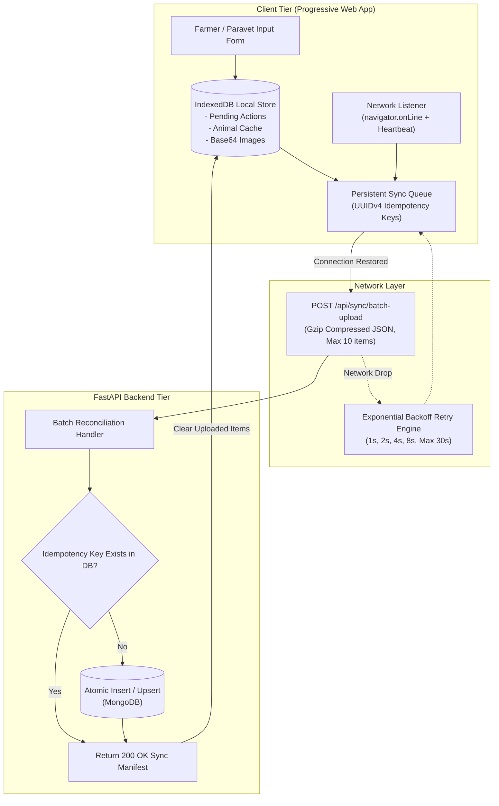

# AniCare AI — Offline-First Architecture & Secure Synchronization

## 1. Rural Connectivity Strategy

Rural livestock farms frequently experience zero cellular connectivity. AniCare AI utilizes an offline-first architecture to guarantee zero data loss and eliminate duplicate submissions upon reconnection.

## 2. Idempotency & Conflict Resolution

1. **Client-Side Generation:** Every action created offline is stamped with a cryptographic UUIDv4 token: `idempotency_key = "idemp_550e8400-e29b-41d4-a716-446655440000"`.
2. **Server-Side Deduplication:** The backend executes atomic `find_one_and_update` operations with upsert semantics keyed on `idempotency_key`. If the device resubmits the same record after an interrupted connection, the server acknowledges success without creating a duplicate record.
3. **Conflict Resolution:** In rare cases of concurrent field edits to the same animal record, the system follows a **Server-Authoritative, Most-Recent-Timestamp** policy: veterinarian edits always override unverified farmer updates.
