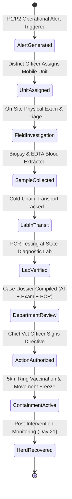

# AniCare AI — Field Response Command & Government Action Workflow

## 1. Operational Response Lifecycle

AniCare AI provides an end-to-end operational workflow linking alert detection directly to rapid field response, biological lab verification, and authorized regulatory containment.

## 2. Priority Escalation Matrix

| Priority Tier | Trigger Condition | Response SLA | Action Protocol |
| :--- | :--- | :--- | :--- |
| **P1 Critical** | Spatial Risk Index $\ge 75$ OR high-confidence transmissible case | $\le 4$ Hours | Immediate Rapid Response Unit dispatch, mandatory biological sampling, cold-chain PCR transit |
| **P2 High** | Spatial Risk Index $50 - 74$ OR multiple unverified village alerts | $\le 12$ Hours | Field paravet inspection, farmer advisory notice, symptom logging |
| **P3 Moderate** | Single suspected animal report with moderate risk ($< 50$) | $\le 24$ Hours | Tele-triage advisory, farmer first-aid guidance, watch & wait |

## 3. Cold-Chain Sample Custody Tracking
Every biological sample is assigned a cryptographic identifier (`SMP-YYYY-XXXX`) and tracks:
- Collection timestamp and geocoordinates.
- Specimen type (skin nodule punch biopsy, EDTA whole blood, nasal swab).
- Cold-chain temperature log ($2^\circ\text{C} - 8^\circ\text{C}$).
- Chain-of-custody signatures at farm gate, transit courier, and state laboratory receiving desk.
