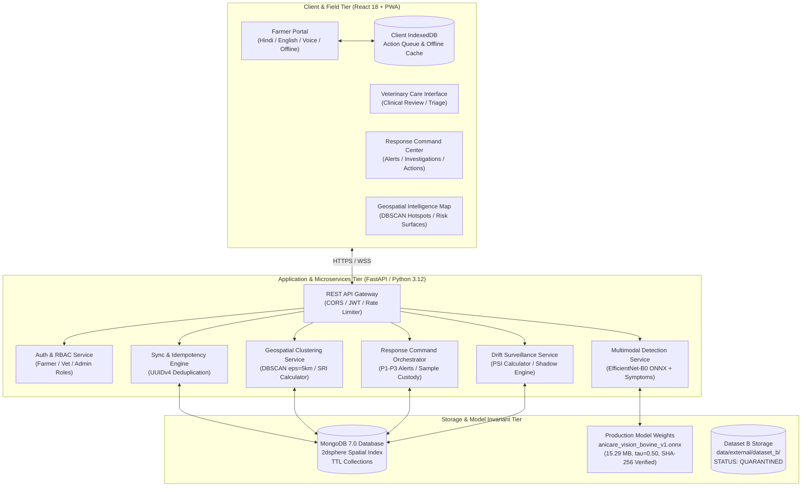

# AniCare AI — System Architecture Specification

## 1. High-Level Architectural Vision

AniCare AI is built on a modern, decoupled, multi-tier architecture engineered for extreme reliability across resource-constrained rural environments. The system balances high-throughput edge data capture with strict statutory governance.

## 2. Core Architectural Principles

1. **Statutory Human-in-the-Loop:** In strict compliance with the Indian Veterinary Council Act, the AI system never acts as an autonomous diagnostic agent or prescribing entity. AI models output decision-support signals; all medical, pharmaceutical, and regulatory actions require verified veterinary credentials.
2. **Offline-First Fault Tolerance:** The field tier never assumes persistent network availability. All data entry forms function completely offline using browser IndexedDB storage and serialize payloads with UUID idempotency keys.
3. **Decoupled Geospatial Aggregation:** Animal-level records are spatially indexed using MongoDB `2dsphere` geometries. Real-time spatial clustering (DBSCAN) aggregates individual cases into village, block, and district early warning signals.
4. **Immutable Scientific Invariants:** Production model weights and validation benchmarks are protected against unauthorized modification. External datasets with unverified licensing (Dataset B) are kept quarantined under `PERMISSION_REQUIRED`.
